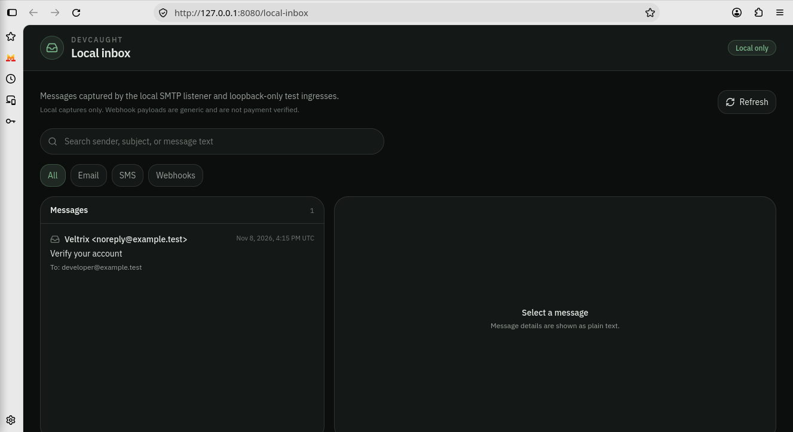

<p align="center">
  
</p>

# DevCaught

**Everything your app sends. Caught.**

> **Local-development preview · V0.2**

DevCaught is a local development inbox for developers building and testing applications. Capture test email through SMTP, synthetic SMS, and JSON webhooks on your machine, then inspect messages and email OTPs or links in a searchable dashboard. It helps you test signup, password reset, notification, and webhook flows without delivering messages to real users or providers.

**CodeYantra Technologies · V0.2**

### Features at a glance

- Local SMTP email capture
- Synthetic SMS capture (no carrier delivery)
- Generic JSON webhook capture
- Searchable Local Inbox with message details and channel filters

## Preview

### Local Inbox



### Email details


### Synthetic SMS capture


All examples use fictional addresses, synthetic phone numbers, and local-only
capture. DevCaught does not deliver these messages to real users or carriers.

### README navigation

- [Quick start](#quick-start)
- [Preview](#preview)
- [What DevCaught is](#what-devcaught-is)
- [What DevCaught is not](#what-devcaught-is-not)
- [Features](#features)
- [Requirements](#requirements)
- [Local services and SMTP setup](#local-services)
- [Local project integration](#local-project-integration)
- [Local HTTP capture details](#local-http-request-requirements)
- [Environment variables](#environment-variables)
- [Scripts](#scripts)
- [Project status and roadmap](#project-status)
- [License](#license)
- [Contributing](CONTRIBUTING.md)

---

## Quick start

DevCaught requires **Node.js 22.13.0 or later**.

```bash
git clone https://github.com/CodeYantra-Technologies/devcaught.git
cd devcaught
npm ci
DATABASE_URL= npm run dev
```

The dashboard and local-capture routes bind to `127.0.0.1:8080` by default.
Open the Local Inbox at <http://127.0.0.1:8080/local-inbox>. The separate
HTTP listener defaults to `127.0.0.1:8025`; it is not the local-capture API.

For local-only use, keep `DATABASE_URL` empty as shown above. The normal app
startup still initializes its separate in-memory PGLite database and applies
the app schema migrations there. A nonempty `DATABASE_URL` selects the
configured application database. `DEVCAUGHT_DB_PATH` controls only the
independent SQLite file used for captured inbox records; it does not select or
isolate the application database. Do not use a production database URL for
local capture.

To make the Vite dashboard reachable over the network for live-preview
development, explicitly opt in:

```bash
DATABASE_URL= DEVCAUGHT_LIVE_PREVIEW=1 npm run dev
```

This binds Vite to `0.0.0.0:8080`; use it only in a trusted, isolated
development environment. Do not use live-preview mode for local three-channel
capture: the local-capture security gate requires an eligible loopback Vite
listener and rejects wildcard listeners. The normal startup remains
loopback-only.

This starts:

| Service | Default |
| --- | --- |
| Vite dashboard and local capture | `http://127.0.0.1:8080/local-inbox` |
| SMTP receiver | `127.0.0.1:1025` |
| Separate HTTP listener | `127.0.0.1:8025` |

The default numeric loopback bind enables **local SMTP capture**. It accepts any
envelope recipient and stores mail in the local SQLite inbox; recipients do not
need private routing registrations. Use this only for local development.

Configure your local app to send development email to DevCaught:

```text
SMTP_HOST=127.0.0.1
SMTP_PORT=1025
SMTP_SECURE=false
```

Then trigger a signup OTP, welcome email, password reset, or magic link from your app. The email appears in the DevCaught dashboard instead of going to a real inbox.

You can also send a sample message from this repo:

```bash
npm run send:test-mail
npm run send:test-mail -- --fixture=link
```

---

## What DevCaught is

DevCaught is a local testing tool for developers testing app email, synthetic
SMS, and generic JSON webhook capture.

Use it when you want to test:

- Signup OTP emails
- Welcome emails
- Password reset links
- Magic login links
- Test receipts or notification emails

Instead of sending real email through Gmail, SendGrid, Resend, Mailgun, or another provider during development, point your app at DevCaught's local SMTP server and inspect the result instantly.

```text
Your local app -> DevCaught SMTP -> SQLite -> Dashboard
```

## What DevCaught is not

DevCaught is intentionally small in V0.2.

- It is not a Gmail inbox.
- It does not read incoming Gmail messages.
- It does not deliver email to real users.
- It does not run in Vercel/Supabase hosted environments via `127.0.0.1`.
- It is not a cloud email service.
- It is not production-ready. The v0.2 release is a local-development preview.
- It does not include supported account authentication, shared accounts, or hosted inboxes; those are deferred to future work.
- It does not send real SMS or push notifications. SMS capture is synthetic and
  local-only; provider callbacks are outside the supported v0.2 preview scope.

`127.0.0.1:1025` means "this same machine". If your app is deployed on Vercel or Supabase, `127.0.0.1` points to their server, not your laptop. DevCaught is for local development.

## Experimental repository configurations

The repository also contains separately selected candidate and integration
configurations for authentication/private APIs, HTTPS, Postgres, and provider
integrations. Examples include `compose.candidate-auth.yaml`,
`compose.private-api-2j2.yaml`, `compose.https-candidate-2k2.yaml`,
`compose.postgres-dev.yaml`, and the SMTP/SMS integration Compose files. These
are experimental and are not part of the supported v0.2 local preview or its
quick start. Explicitly selecting them can enable deferred features or contact
external databases and providers; use only disposable resources and test
credentials. They are not production deployment instructions. Hosted/shared
functionality remains future work, and production remains NO-GO.

## Features

- Loopback-only synthetic SMS and generic JSON webhook capture
- Deterministic OTP and link detection in email
- Local Inbox filters for email, SMS, and webhooks
- Local SMTP capture (`127.0.0.1:1025` by default)
- SQLite storage on disk
- Web dashboard with search, detail, delete, and clear
- Deterministic OTP detection (no AI)
- HTTP(S) link detection
- Copy buttons for OTPs and links
- Sandboxed HTML preview (scripts cannot run; remote images blocked)
- Test email composer (ingest pipeline — not an SMTP health check)
- Settings page that reports **real** SMTP and HTTP listener state

## Requirements

- **Node.js 22.13.0 or later** (Node 22 LTS)

Verified on Node.js 22.23.4 with npm 10.9.9: the built-in `node:sqlite`
driver works **without** `--experimental-sqlite` and **without** a native addon.
That is why DevCaught does not depend on `better-sqlite3`.

`npm install` does not compile C++. The same install works on Windows, macOS, and Linux from the official Node binaries.

Node may print:

```text
ExperimentalWarning: SQLite is an experimental feature and might change at any time
```

That warning is expected and harmless. The store is isolated behind `InboxStore` if the API ever needs to be swapped.

## Local services

| Service | Default | Env |
| --- | --- | --- |
| SMTP server | `127.0.0.1:1025` | `DEVCAUGHT_HOST`, `DEVCAUGHT_SMTP_PORT` |
| HTTP API | `127.0.0.1:8025` | `DEVCAUGHT_HOST`, `DEVCAUGHT_HTTP_PORT` |
| Dashboard | Vite dev server (live reload) | — |

Open the dashboard in your browser, then confirm Settings:

```text
SMTP Server: Running
Host: 127.0.0.1
Port: 1025

Separate HTTP listener: Running
Port: 8025
```

If a port is already taken, DevCaught prints a message like:

```text
DevCaught could not start the SMTP server on 127.0.0.1:1025 because that port is already in use.
Set DEVCAUGHT_SMTP_PORT to a free port, for example:
  DEVCAUGHT_SMTP_PORT=1026 npm run dev
```

## SMTP configuration

In your application:

```text
SMTP_HOST=127.0.0.1
SMTP_PORT=1025
SMTP_SECURE=false
```

No username, password, or TLS. The SMTP capture listener is unauthenticated and
must stay on numeric loopback (`127.0.0.1` or `::1`). Do not set
`DEVCAUGHT_HOST=0.0.0.0` or another network address for local capture: that
disables capture by default, and explicitly selecting
`DEVCAUGHT_SMTP_ROUTING_MODE=local` on such a bind is rejected. Docker's
network-accessible `DEVCAUGHT_HOST=0.0.0.0` configuration therefore cannot use
the local capture policy.

Private SMTP routing is a separate mode (`DEVCAUGHT_SMTP_ROUTING_MODE=private`).
It verifies registered recipients repeatedly and stores only through the
verified inbox scope. This mode is outside the supported v0.2 local-development
preview; this release does not support network or hosted deployment. The local
capture policy is unavailable on network binds.

### Example: Node.js / Nodemailer

```js
import nodemailer from "nodemailer";

const transport = nodemailer.createTransport({
  host: "127.0.0.1",
  port: 1025,
  secure: false,
});

await transport.sendMail({
  from: "Veltrix <noreply@example.test>",
  to: "developer@example.test",
  subject: "Verify your account",
  text: "Your verification code is 482913.\nThis code expires in 10 minutes.",
});
```

From this repo, with DevCaught already running:

```bash
npm run send:test-mail
npm run send:test-mail -- --fixture=link
```

## Local project integration

`npm run dev` starts the dashboard and local-capture middleware on Vite at
`http://127.0.0.1:8080`, plus SMTP at `127.0.0.1:1025` and a separate HTTP
listener at `127.0.0.1:8025`. The local capture routes and Local Inbox API are
on the **Vite origin**; port `8025` is not the local capture endpoint.

For a local-only first run, start with `DATABASE_URL` empty:

```bash
DATABASE_URL= npm run dev
```

The wrapper does not load `DATABASE_URL` from dotenv files, but an exported
shell value is inherited. An empty value selects the in-memory PGLite app
database; normal startup still runs that separate app bootstrap and its schema
migrations. The inbox capture store is a separate SQLite database. Setting
`DEVCAUGHT_DB_PATH` isolates only that capture store and does not protect or
select the app database.

Open the Local Inbox at <http://127.0.0.1:8080/local-inbox>. A same-machine
project can send email using ordinary SMTP settings:

```text
SMTP_HOST=127.0.0.1
SMTP_PORT=1025
SMTP_SECURE=false
```

Local SMTP capture accepts arbitrary envelope recipients. It has no SMTP
username, password, AUTH command, or STARTTLS. The receiver is intended for
loopback development only. `DEVCAUGHT_HOST` controls the SMTP and separate HTTP
listener bind; `DEVCAUGHT_SMTP_PORT` changes the SMTP port. The Vite default is
set in `vite.config.ts`; use the exact Vite port when forming local HTTP URLs.
SMTP DATA is limited to 10 MiB by default; `DEVCAUGHT_SMTP_SIZE_LIMIT` changes
that limit.

The local synthetic HTTP ingresses are:

| Channel | Endpoint | JSON body |
| --- | --- | --- |
| SMS | `http://127.0.0.1:8080/__devcaught/local-inbox/sms` | `{"sender":"+12025550123","recipient":"+12025550199","text":"Synthetic message"}` |
| Webhook | `http://127.0.0.1:8080/__devcaught/local-inbox/webhooks` | Any valid JSON value, for example `{"event":"checkout.created","testId":"example-123"}` |

With DevCaught running, send a synthetic SMS from another terminal:

```bash
curl -i \
  -X POST 'http://127.0.0.1:8080/__devcaught/local-inbox/sms' \
  -H 'Origin: http://127.0.0.1:8080' \
  -H 'Content-Type: application/json' \
  --data '{"sender":"+15005550006","recipient":"+15005550007","text":"Your MaskChat OTP is 482913"}'
```

A successful capture returns `HTTP/1.1 201 Created` with an `ok` response and
the stored message ID. Refresh the Local Inbox and select the **SMS** filter.

Send a generic JSON webhook in the same way:

```bash
curl -i \
  -X POST 'http://127.0.0.1:8080/__devcaught/local-inbox/webhooks' \
  -H 'Origin: http://127.0.0.1:8080' \
  -H 'Content-Type: application/json' \
  --data '{"event":"checkout.created","testId":"example-123"}'
```

Use fictional `example.test` email addresses and synthetic identifiers. The SMS
sample uses fictional North American 555-01xx numbers. Do not send real phone
numbers, personal data, credentials, or production payloads: captures are
stored in the configured local SQLite inbox and are visible in the dashboard.

### Local HTTP request requirements

The local ingress requires all of the following:

- The TCP peer must be loopback.
- `Host` must exactly match the Vite listener authority, such as
  `127.0.0.1:8080`.
- Every POST must include exactly one `Origin` matching the Vite origin, such
  as `http://127.0.0.1:8080`.
- `X-Forwarded-Host`, `X-Forwarded-Proto`, and `X-Forwarded-For` are rejected.
  Do not put a reverse proxy between the client and DevCaught.
- Send JSON with `Content-Type: application/json` (optionally
  `charset=utf-8`). Compressed request bodies are not accepted.

A non-browser client running in the same network namespace can use the numeric
loopback URL, let its HTTP library generate the matching `Host`, and set the
matching `Origin` header. The Node example below does this with built-in
`fetch`. Browser code on another origin cannot satisfy this contract and
cross-origin access is not enabled. `Origin` is a browser security signal, not
authentication; a local process can set it, so this is not a boundary between
untrusted processes on the same machine.

Webhook capture accepts only valid JSON at the exact endpoint above: there are
no arbitrary webhook subpaths or query strings, and form, text, or malformed
JSON bodies are rejected. The request limit is 1 MiB. The payload is formatted
for display, with an `event` or `type` value used as its subject when present.
The Local Inbox API does not expose request headers or a raw request envelope.
Selected sensitive header names are redacted before internal storage; secrets
inside the body remain payload data and should not be sent.

Synthetic SMS accepts exactly the `sender`, `recipient`, and `text` fields.
Phone numbers must use the accepted international format, the request limit is
16 KiB, and the text limit is 1,024 characters. Returned phone numbers are
masked in Local Inbox summaries and details. The record is marked `simulated`
and `local`; this route does not contact a carrier or verify provider
signatures.

The local Inbox API is GET-only and shares this Vite origin:

```text
GET /__devcaught/local-inbox/health
GET /__devcaught/local-inbox/messages?channel=all&limit=20&query=...
GET /__devcaught/local-inbox/messages/{id}
```

The `channel` value can be `all`, `email`, `sms`, or `webhook`. Lists support
search and cursor pagination (up to 50 records per page). The dashboard presents
All, Email, SMS, and Webhooks filters, search, load-more, refresh, and plain-text
message details.

### Local capture versus provider routes

The synthetic SMS and generic JSON endpoints above are local development
ingresses. They are not authenticated and do not verify webhook signatures.
The v0.2 preview supports generic JSON webhook capture only; it does not verify
provider signatures or deliver SMS. Separately configured provider callbacks
are outside this local-preview scope.
The HTTP listener on port `8025` is separate. Its generic `/api/webhooks`
handler is currently fail-closed with `401 Unauthorized`; it is not the local
capture route. The `/api/webhooks/twilio` provider callback is separate and
verifies configured Twilio signatures before ingestion; private SMS routing
adds account and destination checks. Do not expose
the local capture ports to a network or use these synthetic routes for provider
callbacks.

### Run the standalone example from another local project

The example uses only Node built-in modules and targets numeric loopback. Run
DevCaught and the project in the same WSL distribution/network namespace (or
the same local machine). In a Bash shell, create a unique temporary directory
for the capture SQLite store and start DevCaught with no remote application
database configured:

```bash
# In the DevCaught checkout:
DEVCAUGHT_CAPTURE_DIR="$(mktemp -d "${TMPDIR:-/tmp}/devcaught-local-integration.XXXXXX")"
printf 'Disposable capture directory: %s\n' "$DEVCAUGHT_CAPTURE_DIR"
DATABASE_URL= \
DEVCAUGHT_HOST=127.0.0.1 \
DEVCAUGHT_SMTP_ROUTING_MODE=local \
DEVCAUGHT_DB_PATH="$DEVCAUGHT_CAPTURE_DIR/inbox.sqlite" \
npm run dev
```

Then, from the separate project in that same WSL distribution:

```bash
node /path/to/devcaught/examples/local-integration.mjs
```

The example accepts `DEVCAUGHT_SMTP_PORT` and `DEVCAUGHT_VITE_PORT` overrides;
DevCaught itself must be running on the same ports.

The example writes three uniquely marked synthetic captures and verifies them
through the Local Inbox API. It does not clear them or touch the SQLite file
directly. Press `Ctrl+C` in the DevCaught terminal, wait for `npm run dev` to
return to the shell prompt, and confirm the DevCaught process has exited. Do
not clean up if the process is still running or its exit is uncertain. In that
same Bash shell, the guarded cleanup below accepts only the path pattern
created by the `mktemp` command above, rejects a symlinked directory or
database file, and removes only the database and its known sidecars. `rmdir`
fails when anything else remains in the directory.

```bash
(
  set -eu
  : "${DEVCAUGHT_CAPTURE_DIR:?DEVCAUGHT_CAPTURE_DIR is required}"
  case "$DEVCAUGHT_CAPTURE_DIR" in
    "${TMPDIR:-/tmp}"/devcaught-local-integration.??????) ;;
    *) printf '%s\n' 'Refusing unexpected capture directory path' >&2; exit 1 ;;
  esac
  if [ ! -d "$DEVCAUGHT_CAPTURE_DIR" ] || [ -L "$DEVCAUGHT_CAPTURE_DIR" ]; then
    printf '%s\n' 'Refusing missing, non-directory, or symlinked capture path' >&2
    exit 1
  fi
  for file in inbox.sqlite inbox.sqlite-wal inbox.sqlite-shm inbox.sqlite-journal; do
    if [ -L "$DEVCAUGHT_CAPTURE_DIR/$file" ]; then
      printf 'Refusing symlinked database file: %s\n' "$file" >&2
      exit 1
    fi
  done
  rm -f -- "$DEVCAUGHT_CAPTURE_DIR/inbox.sqlite" \
    "$DEVCAUGHT_CAPTURE_DIR/inbox.sqlite-wal" \
    "$DEVCAUGHT_CAPTURE_DIR/inbox.sqlite-shm" \
    "$DEVCAUGHT_CAPTURE_DIR/inbox.sqlite-journal"
  rmdir -- "$DEVCAUGHT_CAPTURE_DIR"
)
```

## Environment variables

| Variable | Default | Purpose |
| --- | --- | --- |
| `DEVCAUGHT_HOST` | `127.0.0.1` | Bind address for SMTP and HTTP |
| `DEVCAUGHT_SMTP_PORT` | `1025` | SMTP listen port |
| `DEVCAUGHT_HTTP_PORT` | `8025` | HTTP API listen port |
| `DEVCAUGHT_DB_PATH` | `data/devcaught.db` | SQLite file (`:memory:` allowed) |
| `DEVCAUGHT_SMTP_SIZE_LIMIT` | `10485760` (10 MB) | Reject oversized SMTP DATA |

## How a message is caught

```text
SMTP Receiver ───────────────┐
Synthetic SMS ingress ───────┼→ Normalizer → SQLite → Local Inbox API → Dashboard
Generic webhook ingress ─────┘
Email/Test composer → Parsers (OTP + links) ─────────↗
```

SMTP and the test composer both call `InboxService.ingest()`. The test composer proves parsing and storage. It does **not** prove that port 1025 is reachable — that is the SMTP status on Settings.

The list endpoint never returns raw MIME. Raw MIME is loaded only from `GET /api/messages/:id/raw`.

## Project layout

```text
apps/server/           SMTP receiver, ingest, SQLite, Express API
packages/parsers/      otpParser, linkParser (pure, tested)
packages/shared/       types and defaults
src/                   React dashboard
data/                  SQLite file (gitignored)
```

The dashboard lives in `src/` so `npm run dev` is a single Vite process that also boots SMTP + HTTP. Parser and storage code stay out of the UI.

## Scripts

```bash
npm run dev                # dashboard + SMTP + HTTP API
npm run test:devcaught     # parsers, store, SMTP capture
npm run test:local-capture # isolated plugin and local Inbox route tests
npm run typecheck          # full TypeScript check
npm run send:test-mail     # send a synthetic email to local SMTP
```

## Brand assets

<p>
  
</p>

- Primary SVG logo: `public/devcaught-logo.svg`
- App mark: `public/devcaught-mark.svg`
- Generated concept: `public/devcaught-logo-concept.png`

## Project status

V0.2 is a local developer tool. It is useful the first time an app sends mail. It is not a product inbox, not a cloud service, and not an email client.

## Roadmap

**V0.1**
- Email capture
- OTP detection
- Link detection

**V0.2 — implemented**
- Local SMTP and JSON webhook capture
- Synthetic SMS capture
- Email OTP and link detection

**V0.3**
- Push notification simulation

**Future**
- Account authentication, shared accounts, hosted inboxes, and hosted service
  (deferred; not part of v0.2)
- PWA installation (deferred)
- Test personas
- Plugin / parser system
- Optional self-hosted deployment

## License

MIT © CodeYantra Technologies
